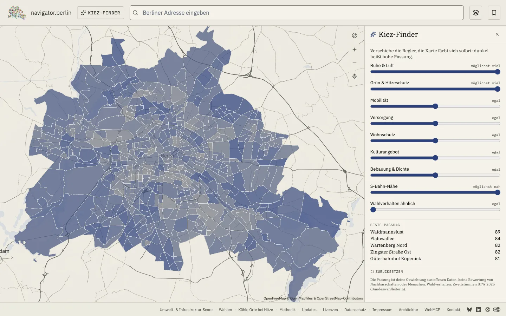
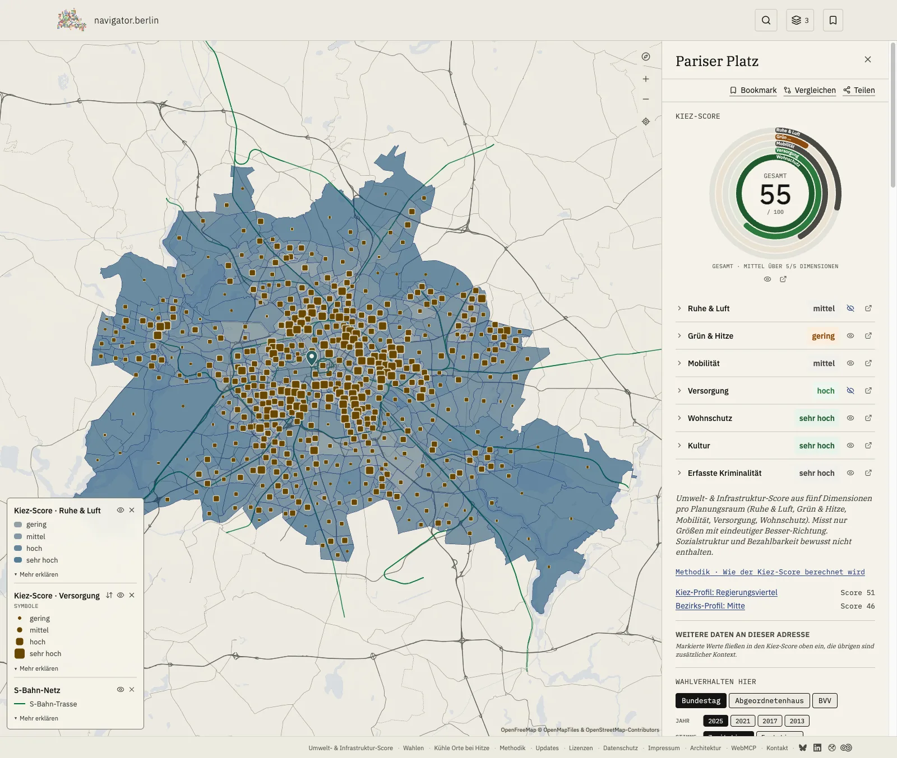

# navigator.berlin

Cross-layer Berlin atlas: address-level inspection across 73 open-data layers (climate, noise, mobility, heritage, demographics) on one map.

Live: <https://navigator.berlin>





The interface is available in German and English. German is the default, since the data and the audience are Berlin's. Code, commits and this file are English.

## Setup

```sh
pnpm install
pnpm dev
```

Requirements: Node.js 22 (see `.nvmrc`), pnpm 10.

The map, all geo layers and the Kiez-Finder run with no further configuration: `static/` ships the generated data.

**Postgres is optional.** Election results and supplementary data (FAQ, ranks, comparisons) come from a local Postgres database. Without `DATABASE_URL`, the election detail pages `/berlin-wahlen/<slug>` answer 503 and the Bezirk and Kiez pages render with reduced data; everything else works. Setup: [`docs/runbooks/local-postgres-setup.md`](./docs/runbooks/local-postgres-setup.md), variables: [`.env.example`](./.env.example).

## WebMCP

navigator.berlin registers 11 tools through the [WebMCP API](https://webmachinelearning.github.io/webmcp/), ten of them read-only. Browser agents (ChatGPT's in-app browser, Chrome 149 with the WebMCP flag) can look up addresses, query layers at a coordinate, compare election results and drive the Kiez-Finder.

The finder is the collaborative part: `set_finder_weights` moves the sliders and the map recolors in front of the human, `get_finder_state` reads back what the human adjusted afterwards. Every answer carries a link that reopens that exact map in any browser.

- Tool manifest: [`/webmcp-manifest.json`](https://navigator.berlin/webmcp-manifest.json)
- Live diagnostics: [`/webmcp`](https://navigator.berlin/webmcp)
- Notes: [`docs/webmcp-challenge.md`](./docs/webmcp-challenge.md)

## Data pipeline

Layers and aggregates are produced by build scripts (`pnpm data:*`), declared source by source in `scripts/lib/sources.ts`. Sequence and dependencies: [`docs/data-pipeline.md`](./docs/data-pipeline.md).

## Data sources

Open data from ODIS Berlin, Umweltatlas (SenMVKU), Geoportal Berlin/FIS-Broker, OpenStreetMap, Bundeswahlleiterin, Amt für Statistik Berlin-Brandenburg, Polizei Berlin (Kriminalitätsatlas) and DWD Climate Data Center. Every license and attribution: [navigator.berlin/lizenzen](https://navigator.berlin/lizenzen).

## Stack

SvelteKit 2 · Svelte 5 (runes) · TypeScript strict · Tailwind v4 · Paraglide v2 (German and English) · MapLibre GL · Layerchart · D3 · Turf · Bits UI · WebMCP · Vitest · Playwright.

Architecture decisions live in `docs/adr/`.

## Development process

The project is built with the [BMAD method](https://github.com/bmad-code-org/BMAD-METHOD) and AI coding agents. Specs, stories, planning documents and audits live in [`docs/process/`](./docs/process/). They are working logs written while building, not user documentation. Statements in them can be outdated; the code and the ADRs in `docs/adr/` are authoritative.

## Contributing and security

See [`CONTRIBUTING.md`](./CONTRIBUTING.md). Report vulnerabilities as described in [`SECURITY.md`](./SECURITY.md).

## License

MIT, see [`LICENSE`](./LICENSE).
